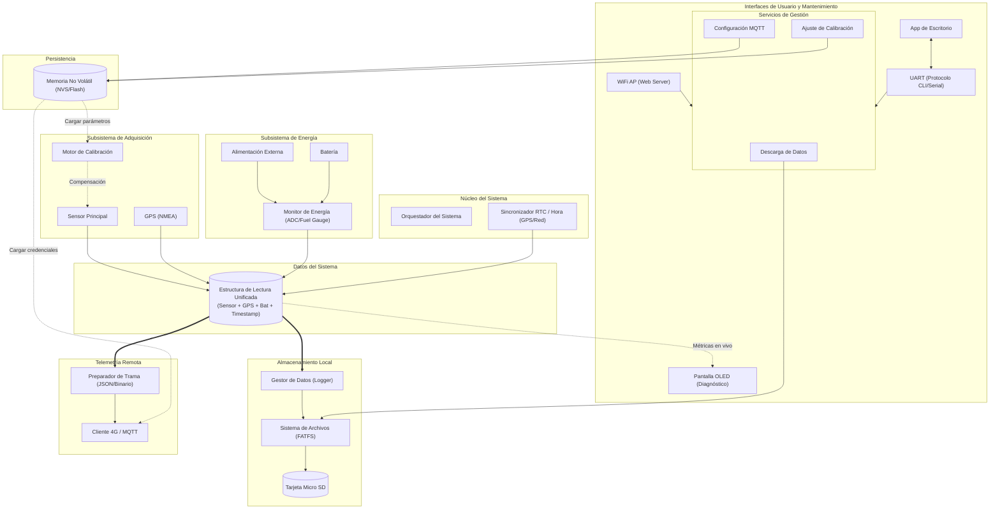

# BASE - Sistema de Sensores Geocientíficos

Proyecto base de firmware y arquitectura modular para sistemas embebidos de adquisición, almacenamiento y telemetría de sensores, desarrollado para el **Grupo de Investigación en Tecnologías Geocientíficas (SGC)**.

---

## 🏛️ Arquitectura del Sistema

El sistema implementa una arquitectura modular desacoplada basada en eventos y un modelo de datos unificado (*Snapshot*):



---

## 📁 Estructura del Proyecto

```text
├── config/                  # Mapeo de pines de la placa y configuraciones base
├── drivers/                 # Capa de abstracción de hardware (I2C, SPI, UART, ADC, SD)
├── src/
│   ├── acquisition/         # Sensores, calibración y GPS
│   ├── communication/       # Módem 4G celular, cliente MQTT y empaquetado de trama
│   ├── core/                # Orquestador del sistema, sincronización RTC y bus de eventos
│   ├── interfaces/
│   │   ├── desktop_comm/    # Protocolo serie para conexión con la App de escritorio
│   │   ├── display/         # Interfaz para pantalla OLED de diagnóstico
│   │   └── wifi/            # Modo WiFi Access Point y servidor web integrado
│   ├── models/              # Estructuras de datos (Snapshot unificado y configuraciones)
│   ├── power/               # Monitoreo de batería y detección de alimentación externa
│   ├── services/            # Servicios de gestión compartidos (descarga, config, calibración)
│   └── storage/             # Registro en Micro SD (FATFS) y memoria no volátil (NVS)
└── web_assets/              # Archivos estáticos de la interfaz web (HTML, CSS, JS)
```

---

## ⚙️ Principios de Diseño

1. **Snapshot Unificado:** Los módulos de adquisición producen lecturas que alimentan una única estructura (`system_reading_t`), evitando acoplamiento entre sensores y medios de transmisión.
2. **Servicios Compartidos:** La API REST del servidor web (WiFi AP) y el protocolo serie (UART) invocan la misma capa `services/`, eliminando duplicidad de código.
3. **Persistencia Segura en NVS:** Parámetros de calibración y credenciales MQTT residen en la flash interna del microcontrolador (NVS), manteniendo la operatividad aún sin tarjeta SD insertada.
4. **Concurrencia Protegida:** El acceso a la Micro SD mediante FATFS está protegido por exclusión mutua para evitar corrupción entre la escritura continua del registrador y la descarga de datos.
